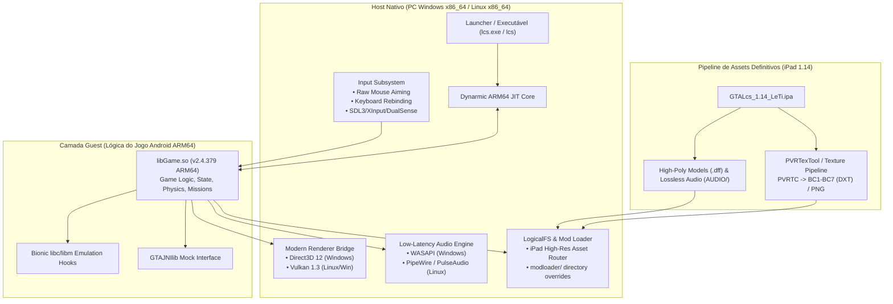

# GTA: Liberty City Stories — Native PC Port (Dynarmic ARM64 Runtime & iOS Definitive Assets)
## Especificação Técnica e Plano de Arquitetura do Projeto

> **Status:** Aprovado para Desenvolvimento  
> **Arquitetura Base:** Executável Nativo Windows (`lcs.exe`) e Binário Nativo Linux (`lcs`)  
> **Motor de Execução:** Dynarmic ARM64 JIT (Recompilação Dinâmica de `libGame.so` v2.4.379)  
> **Renderização Gráfica:** Exclusivamente **Direct3D 12** (Windows) e **Vulkan 1.3** (Linux / Windows)  
> **Assets Gráficos e Sonoros:** Pacote Definitivo do iPad 1.14 (Texturas Retina, Modelos de Alta Densidade e Áudio Sem Perdas)  
> **Filosofia do Projeto:** Paridade estrutural, tooling e modding com o [gta-vcs-recomp](https://github.com/willzmkv/gta-vcs-recomp)

---

## 1. Visão Geral e Motivação

*Grand Theft Auto: Liberty City Stories* (LCS) é um dos poucos títulos da era 3D da Rockstar Games que nunca recebeu uma versão oficial para PC (Windows/Linux). Os jogadores de PC historicamente dependiam de emuladores de PSP (PPSSPP) ou de PS2 (PCSX2), que sofrem com limitações de taxa de quadros, resolução de texturas da época de consoles portáteis de 2005 e esquemas de controle adaptados.

Em dispositivos ARM64 portáteis (como o console R36S com PortMaster), o jogo foi viabilizado através do `lcs_runtime`, que executa o código nativo Android ARM64 (`libGame.so`) mapeado diretamente no kernel Linux.

### O Objetivo Deste Projeto
Criar o **porte definitivo de GTA Liberty City Stories para PC**, adotando uma arquitetura simétrica ao **GTA Vice City Stories PC Port** (`gta-vcs-recomp`):
1. **Zero Emuladores / Zero Máquinas Virtuais:** Um executável nativo leve e direto para Windows e Linux.
2. **Motor de CPU Dynarmic:** Execução JIT de altíssima performance para a lógica ARM64 do `libGame.so`.
3. **Pipeline Gráfico Moderno:** Renderizadores puros em **DirectX 12** e **Vulkan 1.3**, eliminando overheads de OpenGL/EGL e garantindo baixo uso de CPU e alto throughput de draw calls.
4. **Edição Definitiva com Assets do iPad:** Extração e injeção completa dos arquivos da versão de iOS/iPad (v1.14), convertendo as 9.176 texturas Retina de alta fidelidade, modelos poligonais enriquecidos, shaders de iluminação/sombras dinâmicas e trilha sonora de alta qualidade.
5. **Experiência de PC Moderna:** Taxa de quadros desbloqueada (60, 120, 144, 240+ FPS sem bugs de física), suporte nativo a mira com mouse, controles modernos (XInput e DualSense) e um **Mod Loader** integrado no mesmo formato de pastas do `gta-vcs-recomp`.

---

## 2. Diagrama de Arquitetura do Sistema



---

## 3. Pilares Técnicos da Implementação

### 3.1. Núcleo de Execução da CPU (Dynarmic JIT)
* **Guest ABI:** AArch64 (ARM64 v8-a).
* **Host ABI:** x86_64 (Windows x64 / Linux x86_64).
* **Motor:** `dynarmic` (desenvolvido pela equipe do Citra/Yuzu/Vita3K).
* **Mapeamento de Memória:** Alocação de memória virtual através de `VirtualAlloc` (Windows) ou `mmap` (Linux), fornecendo o espaço de endereçamento linear esperado pelas bibliotecas ELF64.
* **Intercepção de Chamadas Externas (Fast Callbacks):**
  * As importações de bibliotecas compartilhadas (libc, libm, EGL, GLES, OpenAL) do `libGame.so` são interceptadas via instruções customizadas de trap/SVC no Dynarmic.
  * Quando o jogo faz uma chamada para uma função de sistema (ex: `malloc`, `fopen`, `glDrawElements`), o Dynarmic desvia instantaneamente para a implementação nativa C++ em x86_64 sem overhead de context-switch.

### 3.2. Pipeline de Renderização: Direct3D 12 e Vulkan Apenas
O jogo original em Android utiliza OpenGL ES 2.0 / 3.0. Em placas de vídeo modernas de PC, drivers de OpenGL/GLES possuem alto consumo de CPU e overheads significativos em cenas densas de tráfego e pedestres. Por isso, **a renderização usará exclusivamente Direct3D 12 e Vulkan**:

1. **Backend Direct3D 12 (Padrão no Windows):**
   * Criação nativa de dispositivo D3D12 (`ID3D12Device`), filas de comando diretas (`ID3D12CommandQueue`) e swap chain DXGI com suporte a Variable Refresh Rate (G-Sync/FreeSync).
   * Gerenciamento de Pipeline State Objects (PSOs) e Root Signatures pré-compiladas.
   * Alocação de descritores via Ring Buffers para máxima eficiência em uploads de vértices e texturas dinâmicas.
2. **Backend Vulkan 1.3 (Padrão no Linux, disponível no Windows):**
   * Uso de `VK_KHR_dynamic_rendering` para dispensar Render Passes tradicionais e renderizar diretamente nos anexos de cores/profundidade.
   * Sincronização via Timeline Semaphores.
   * Pipeline Caching persistente em disco para eliminar qualquer stuttering durante o carregamento de novas áreas da cidade.
3. **Tradução e Enriquecimento de Shaders:**
   * Os shaders GLSL originais do jogo (`PassThrough`, `SimpleTextured`, `Effect3D`, `BlobShadow`, `PostProcess`, `Water`) são traduzidos para HLSL (D3D12) e SPIR-V (Vulkan) via **SPIRV-Cross** e compilados em tempo de compilação ou na primeira inicialização.
   * Integração dos shaders avançados do iPad: sombras projetadas de alta definição (`BlobShadowVs.glsl`), iluminação dinâmica com reflexos no asfalto molhado e correção de cor / bloom pós-processamento.

### 3.3. Áudio de Baixa Latência (WASAPI e PipeWire)
* Ponte sobre a biblioteca OpenAL Soft customizada.
* No Windows: saída direta via **WASAPI Exclusive / Low-Latency Shared Mode**.
* No Linux: saída nativa via **PipeWire / PulseAudio**.
* **Trilha Sonora e Sons:** Substituição do `data_music.wad` compactado de Android pelos arquivos de áudio originais sem compressão da pasta `AUDIO/` do iPad, garantindo estações de rádio em estéreo cristalino e efeitos sonoros ricos.

### 3.4. O Sistema de Arquivos VFS, Mod Loader e Injeção dos Assets do iPad
* **Interceptação do LogicalFS:**
  * No `libGame.so`, a Rockstar utiliza a classe `LogicalFS` (`LogicalFS_OpenBundleFile` e `LogicalFS_MountWadFromPhysicalFilePath`).
  * O runtime injeta um interceptador no VFS: antes de buscar qualquer arquivo dentro do `data_main.wad`, ele verifica prioritariamente:
    1. A pasta `modloader/` (mods ativos do usuário com ordem de prioridade).
    2. A pasta de assets soltos extraídos do iPad (`assets/ipad/`).
    3. O arquivo `data_main.wad` original como fallback de compatibilidade.
* **Pipeline de Conversão de Texturas (PVRTC -> DXT / PNG):**
  * O iPad utiliza 9.176 texturas `.pvr` em formato PVRTC (nativo das GPUs Apple PowerVR).
  * Como placas de PC (NVIDIA, AMD, Intel) não suportam PVRTC, a ferramenta `tools/texture_convert.py` realiza a descompressão e recodificação para **BC1 / BC3 / BC7 (DirectXTex / S3TC)** ou **PNG de alta resolução**.
  * Como o `libGame.so` já possui suporte verificado a `GL_EXT_texture_compression_s3tc`, as texturas convertidas em DXT são carregadas com 100% de aceleração de hardware e ocupam pouca memória VRAM.

### 3.5. Controles, Câmera e Qualidade de Vida para PC
* **Mira com Mouse e Câmera Livre:** Mapeamento do delta do mouse direto para a matriz de rotação da câmera de Tommy/Toni, eliminando a aceleração estranha de joystick.
* **Controles:** Suporte nativo completo a controles Xbox (XInput) e PlayStation DualSense/DualShock 4 com layout correto de botões na tela (Cross, Circle, Square, Triangle).
* **Taxa de Quadros Desbloqueada:** Ajuste no temporizador da engine para desacoplar a taxa de quadros (30 FPS original de celular) da física do jogo, permitindo **60 FPS a 240+ FPS suaves**.
* **Ajuste de Câmera e Aspect Ratio:** Suporte nativo a telas 16:9, 16:10, 21:9 e 32:9 (Ultra-wide e Super Ultra-wide) sem distorção dos ícones do HUD ou corte de campo de visão (FOV).

---

## 4. Estrutura do Repositório (Padrão `gta-vcs-recomp`)

```
gta-lcs-recomp/
├── .github/                  # CI/CD workflows de compilação automática Windows e Linux
├── .gitignore                # Bloqueio estrito de arquivos protegidos por direitos autorais
├── CMakeLists.txt            # Configuração unificada do CMake para MSVC, Clang-cl e GCC
├── AGENTS.md                 # Diretrizes para agentes de IA e desenvolvedores do projeto
├── README.md                 # Documentação principal e guia de início rápido
├── PROJECT_PLAN.md           # Este plano arquitetural detalhado
├── VERSION                   # Versão semântica do projeto (ex: 0.1.0-alpha)
│
├── docs/                     # Documentação técnica aprofundada
│   ├── ARCHITECTURE.md       # Detalhes de memória, Dynarmic e pontes Bionic
│   ├── ASSET_PIPELINE.md     # Especificação do extrator de IPA e conversor de PVRTC
│   ├── RENDERER_D3D12.md     # Arquitetura do backend Direct3D 12
│   ├── RENDERER_VULKAN.md    # Arquitetura do backend Vulkan 1.3
│   └── MOD_LOADER.md         # Como criar e empacotar mods para o jogo
│
├── src/                      # Código-fonte C++20 nativo
│   ├── core/                 # Inicialização do executável, configuração e main loop
│   │   ├── main.cpp
│   │   ├── config.cpp
│   │   └── memory.cpp
│   ├── cpu/                  # Integração com o Dynarmic ARM64 JIT
│   │   ├── dynarmic_core.cpp
│   │   ├── elf_loader.cpp
│   │   └── callbacks.cpp
│   ├── os/                   # Simulação do ambiente Android Bionic & JNI
│   │   ├── bionic_libc.cpp
│   │   ├── bionic_libm.cpp
│   │   ├── jni_bridge.cpp
│   │   └── thread_manager.cpp
│   ├── graphics/             # Backends gráficos modernos
│   │   ├── r_d3d12/          # Implementação Direct3D 12
│   │   ├── r_vulkan/         # Implementação Vulkan 1.3
│   │   ├── shader_compiler.cpp
│   │   └── window.cpp
│   ├── audio/                # Mixer de áudio de baixa latência
│   │   ├── audio_system.cpp
│   │   └── openal_bridge.cpp
│   ├── vfs/                  # Sistema de arquivos virtual e Mod Loader
│   │   ├── logical_fs.cpp
│   │   ├── mod_loader.cpp
│   │   └── wad_archive.cpp
│   └── input/                # Teclado, mouse e controles
│       ├── input_system.cpp
│       ├── mouse_aim.cpp
│       └── gamepad.cpp
│
├── tools/                    # Ferramentas Python (somente biblioteca padrão + utilitários)
│   ├── build.py              # Script principal de build (--opt lto, --quick, etc.)
│   ├── doctor.py             # Diagnóstico completo de ambiente, hardware e arquivos
│   ├── extract_ipa.py        # Extrator e catalogador de assets do iPad (.ipa)
│   ├── texture_convert.py    # Conversor em lote de PVRTC para DXT/BC7 e PNG
│   └── wad_tool.py           # Leitor, extrator e validador de arquivos data_main.wad
│
├── modloader/                # Diretório onde os mods do usuário são instalados
│   └── README.md
│
└── third_party/              # Dependências e bibliotecas integradas
    ├── dynarmic/             # Núcleo JIT ARM64
    ├── volk/                 # Meta-loader Vulkan
    └── SDL/                  # Camada de janela e eventos (SDL3 / SDL2)
```

---

## 5. Cronograma e Fases de Execução

| Fase | Foco Principal | Entregáveis |
| :--- | :--- | :--- |
| **Fase 1** | **Fundação do Runtime & Tooling** | • Repositório GitHub criado e estruturado.<br>• Tooling `doctor.py` e `build.py` operacionais.<br>• CMakeLists.txt configurado com integração do Dynarmic e SDL.<br>• Mapeador ELF64 e ponte inicial de símbolos Bionic. |
| **Fase 2** | **Renderização D3D12 & Vulkan** | • Dispositivo D3D12 e instância Vulkan inicializados na janela do jogo.<br>• Tradução das chamadas de draw e matrizes de visão.<br>• Shaders GLES compilados em HLSL e SPIR-V.<br>• Primeira tela do jogo (Logos e Menu Principal) desenhada nativamente. |
| **Fase 3** | **Áudio, Input e Loop de Gameplay** | • Implementação completa do JNI `GTAJNIlib`.<br>• Áudio funcionando via WASAPI e PipeWire com OpenAL Soft.<br>• Suporte a controle (XInput/DualSense) e mouse nativo para câmera.<br>• Carregamento de saves e jogo jogável em 3D. |
| **Fase 4** | **Pipeline de Assets do iPad (Edição Definitiva)** | • Execução do script `extract_ipa.py` sobre `GTALcs_1.14_LeTi.ipa`.<br>• Conversão em lote das 9.176 texturas `.pvr` para DXT/BC7.<br>• Injeção dos modelos de alta contagem poligonal e arquivos de áudio.<br>• Ativação de sombras e iluminação dinâmica da versão iOS. |
| **Fase 5** | **Polimento PC & Mod Loader** | • Desbloqueio e estabilização de 60+ FPS sem bugs de física.<br>• Suporte a resoluções Ultra-wide e ajustes dinâmicos de FOV.<br>• Mod Loader ativo para pastas em `modloader/`.<br>• Geração de releases binárias portáteis para Windows e Linux. |

---

## 6. Conformidade Legal e Preservação

Assim como no `gta-vcs-recomp`:
1. **Nenhum arquivo proprietário ou protegido por direitos autorais** (arquivos `.ipa`, `.apk`, `.wad`, `.so` ou músicas) será versionado ou distribuído no repositório.
2. O projeto distribui estritamente o **código-fonte do runtime**, os scripts de ferramentas e os arquivos de compilação sob licença aberta (GPL-3.0 / MIT).
3. O usuário final deve fornecer seus próprios arquivos legalmente obtidos (adquiridos pela Google Play Store e Apple App Store), que serão processados localmente pelas ferramentas do projeto em sua própria máquina.
