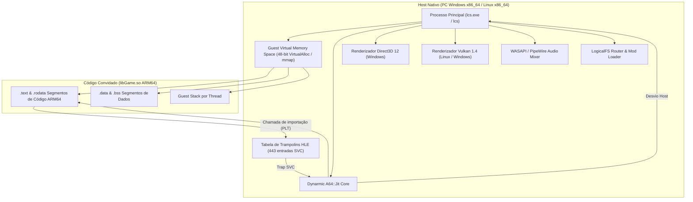
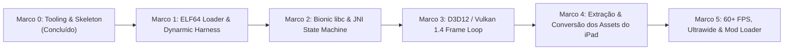

# GTA: Liberty City Stories — Native PC Port (Dynarmic ARM64 Runtime & iOS Definitive Assets)
## Especificação Técnica e Plano de Engenharia Reversa

- **Arquitetura Base:** Executável Nativo Windows (`lcs.exe`) e Binário Nativo Linux (`lcs`)  
- **Motor de Execução:** Dynarmic ARM64 JIT (Recompilação Dinâmica de `libGame.so` v2.4.379)  
- **Renderização Gráfica:** Exclusivamente **Direct3D 12** (Windows) e **Vulkan 1.4** (Linux / Windows)  
- **Assets Gráficos e Sonoros:** Pacote Definitivo do iPad 1.14 (Texturas Retina, Modelos de Alta Densidade e Áudio Sem Perdas)  
- **Filosofia do Projeto:** Paridade estrutural, tooling e modding com o [gta-vcs-recomp](https://github.com/willzmkv/gta-vcs-recomp)

---

## 1. Visão Geral e Desafios de Engenharia

Grand Theft Auto: Liberty City Stories (LCS) nunca recebeu um lançamento oficial para PC. A versão portátil para o console R36S (PortMaster) funciona porque o hardware do R36S é baseado em processadores Rockchip ARM64 (AArch64), o que permite ao sistema carregar o `libGame.so` de Android diretamente na memória e executá-lo nativamente na CPU.

Em PCs convencionais (processadores Intel e AMD de arquitetura x86_64), **a CPU não compreende o conjunto de instruções ARM64**. A Rockstar nunca compilou uma versão x86_64 de `libGame.so`.

Portanto, o objetivo deste projeto é construir um **harness nativo de alto desempenho baseado no motor JIT Dynarmic**, em conjunto com uma camada de tradução de chamadas de sistema (HLE) e renderizadores modernos em Direct3D 12 e Vulkan 1.4, integrando os assets da versão 1.14 de iPad (iOS).

---

## 2. Análise Detalhada do Binário `libGame.so` (v2.4.379 ARM64)

Uma análise estática aprofundada do cabeçalho ELF64, tabelas dinâmicas e relocação do `libGame.so` revelou os seguintes parâmetros estruturais:

### 2.1. Métricas do Executável
- **Arquitetura ELF:** ELF64, AArch64 (Machine 183), Little-Endian.
- **Tamanho da Imagem:** 8.671.264 bytes no disco (~13.398.016 bytes mapeados em memória virtual).
- **Cabeçalhos de Programa (Program Headers):** 9 segmentos (`PT_PHDR`, `PT_LOAD` x4, `PT_DYNAMIC`, `PT_NOTE`, `PT_GNU_EH_FRAME`, `PT_GNU_STACK`).
- **Total de Símbolos Dinâmicos:** 18.625 símbolos.
- **Símbolos Exportados (Lógica do Jogo / JNI):** 18.181 símbolos.
- **Símbolos Importados (Dependências Externas):** 443 símbolos.

### 2.2. Classificação dos 443 Símbolos Importados
Para que o `libGame.so` seja executado via Dynarmic em x86_64 sem falhas de paginação ou instruções ilegais, o runtime host precisa prover implementações nativas ou stubs para todas as 443 chamadas:

| Subsistema | Quantidade | Exemplos de Símbolos Críticos |
| :--- | :--- | :--- |
| **OpenGL ES 2.0 / 3.0** | 141 | `glDrawElements`, `glDrawArrays`, `glBindTexture`, `glUniformMatrix4fv`, `glShaderSource`, `glCompileShader`, `glCompressedTexImage2D` |
| **Bionic libc / libm** | 136 | `malloc`, `free`, `fopen`, `fread`, `fwrite`, `clock_gettime`, `gettimeofday`, `sinf`, `cosf`, `atan2f` |
| **C++ ABI (libstdc++/libc++)** | 78 | `__cxa_atexit`, `__cxa_finalize`, `_ZdaPv`, `_Znwm`, `_ZdlPv`, typeinfo e vtables padrão |
| **POSIX Threads (pthread)** | 26 | `pthread_create`, `pthread_join`, `pthread_mutex_lock`, `pthread_mutex_unlock`, `pthread_cond_wait`, `pthread_key_create` |
| **OpenAL Audio** | 23 | `alSourcePlay`, `alSourceStop`, `alBufferData`, `alSourceQueueBuffers`, `alcCreateContext`, `alcMakeContextCurrent` |
| **Android NDK** | 16 | `AAssetManager_open`, `AAsset_read`, `ANativeWindow_fromSurface`, `__android_log_print` |
| **mpg123 Audio Decoder** | 12 | `mpg123_init`, `mpg123_open_feed`, `mpg123_decode`, `mpg123_close` |
| **EGL Windowing / Surface** | 11 | `eglGetDisplay`, `eglInitialize`, `eglChooseConfig`, `eglCreateWindowSurface`, `eglSwapBuffers`, `eglGetProcAddress` |

### 2.3. Tipos de Relocação Presentes
O carregador ELF customizado do runtime precisará processar 4 categorias de relocação em tempo de carregamento:
1. `R_AARCH64_RELATIVE` (4.271 ocorrências): Ajustes diretos com base no load bias da memória virtual.
2. `R_AARCH64_ABS64` (5.185 ocorrências): Relocações absolutas de 64 bits para ponteiros e tabelas de ponteiros de funções virtuais.
3. `R_AARCH64_GLOB_DAT` (3.595 ocorrências): Resolução de dados globais entre módulos.
4. `R_AARCH64_JUMP_SLOT` (7.128 ocorrências): Entradas da tabela PLT (Procedure Linkage Table).

### 2.4. Ciclo de Vida e Exportações JNI (O Game Loop)
O jogo expõe 64 funções de ciclo de vida JNI que controlam o fluxo de execução:
1. `JNI_OnLoad(JavaVM*, void*)` (0x56ad5c): Inicialização da biblioteca de jogo e registro dos métodos nativos.
2. `setAssetManager` / `setAssetPacksInfo` (0x56af70 / 0x56b038): Configuração das rotas de assets e do WAD.
3. `setPrivateFilesDir` (0x56af9c): Definição do diretório de saves (`userdata/`).
4. `viewOnSurfaceCreated` / `viewOnSurfaceChanged` (0x56c340 / 0x56c344): Inicialização das dimensões de tela e viewport.
5. `viewOnDrawFrame` (0x56c85c): **O frame loop principal da engine**, chamado a cada quadro para atualizar a simulação e desenhar a cena.
6. `onJoyButtonDown` / `onJoyButtonUp` / `setJoyAxis` (0x56c114 / 0x56c184 / 0x56c068): Processamento de entrada dos controles.

---

## 3. Arquitetura da Solução Nativa com Dynarmic



### 3.1. Gerenciamento de Memória Virtual
- No Windows, uma região contígua de 4 GB ou mais é reservada usando `VirtualAlloc(..., MEM_RESERVE, PAGE_NOACCESS)` em um endereço base alinhado (ex: `0x7f80000000`).
- Os segmentos `PT_LOAD` do `libGame.so`, `libopenal.so` e `libVendor_mpg123.so` são mapeados nessa região com suas respectivas proteções (`PAGE_READONLY`, `PAGE_READWRITE`, `PAGE_EXECUTE_READ`).
- A tabela de páginas do Dynarmic (`MemoryRead*` e `MemoryWrite*`) aponta diretamente para esse mapeamento de memória, garantindo que instruções de leitura e escrita de ponteiros guest funcionem com custo mínimo de tradução.

### 3.2. Mecanismo de Trampolim HLE (High-Level Emulation)
Para que as 443 funções importadas sejam executadas nativamente no host x86_64:
1. Uma página especial de código guest é reservada para trampolins (`0x7f00000000`).
2. Cada função importada recebe um índice sequencial (0 a 442). No endereço do trampolim correspondente, injeta-se a instrução ARM64:
   ```arm64
   SVC #<index>
   RET
   ```
3. Todas as entradas `R_AARCH64_JUMP_SLOT` da tabela PLT do `libGame.so` são resolvidas para apontar para o trampolim da respectiva função.
4. Quando a CPU convidada executa a chamada via Dynarmic, o Dynarmic intercepta a instrução `SVC`, interrompe temporariamente a execução do bloco guest e chama o tratador host:
   ```cpp
   void handle_svc_trap(uint32_t index, Dynarmic::A64::Jit& jit);
   ```
5. O tratador host lê os argumentos da chamada de acordo com a convenção de chamada ARM64 (registradores `X0` a `X7` para inteiros/ponteiros e `D0` a `D7` para ponto flutuante), converte ponteiros do espaço guest para ponteiros de memória host, executa a implementação em C++ nativo (ex: aloca memória ou registra um comando no Direct3D 12 / Vulkan 1.4), escreve o resultado em `X0`/`D0` e avança o program counter (`PC += 4`).

### 3.3. Por que Vulkan 1.4 em vez do 1.3?
A adoção do **Vulkan 1.4** traz vantagens determinantes para a arquitetura de tradução gráfica:
1. **Push Descriptors no Núcleo (`VK_KHR_push_descriptor`):**
   No motor RenderWare Leeds do LCS, cada chamada de draw frequentemente atualiza uniformes de matrizes de modelo, visão e projeção. No Vulkan 1.3 tradicional, isso exigia a criação e reciclagem contínua de Descriptor Sets em pools de descritores. No Vulkan 1.4, os descritores são gravados diretamente no buffer de comando (`vkCmdPushDescriptorSetKHR`), espelhando a simplicidade dos Root Descriptors e Root Constants do Direct3D 12.
2. **Dynamic Rendering com Leitura Local (`VK_KHR_dynamic_rendering_local_read`):**
   Elimina completamente a complexidade de `VkRenderPass` e `VkFramebuffer`, permitindo leitura direta de anexos de cor e profundidade para efeitos pós-processamento e sombras.
3. **Pipeline Robustness e Dynamic State Integrados:**
   Garante compatibilidade robusta contra estados inválidos de viewport, scissor e formatos de vértices sem necessidade de recompilar pipelines para variações triviais de estado.

---

## 4. O Pipeline de Assets Definitivos (iPad 1.14)

### 4.1. Análise Comparativa dos Formatos de Textura
- O iPad possui 9.176 texturas compactadas com o algoritmo **PVRTC (PowerVR Texture Compression)**, que depende de arquitetura de blocos proprietária da Apple/Imagination.
- Placas de vídeo de PC modernas suportam nativamente compressão **BC1/BC2/BC3 (DXT1/DXT3/DXT5)** e **BC7**.
- Como o `libGame.so` contém referências diretas a `GL_EXT_texture_compression_s3tc`, as texturas convertidas para DXT são carregadas nativamente sem descompactação em software na CPU.

### 4.2. Estratégia de Injeção no VFS
O runtime interceptará a função `LogicalFS_OpenBundleFile` com uma cadeia de resolução ordenada:
1. `modloader/<nome_do_mod>/` (se o arquivo existir em qualquer mod ativo, ele tem prioridade máxima).
2. `assets/ipad/` (arquivos extraídos e texturas convertidas do iPad).
3. `assets/android/data_main.wad` (leitura do container original apenas para dados ausentes ou de fallback).

---

## 5. Roteiro de Engenharia em Fases (Roadmap)



### Marco 0: Estrutura Base e Tooling (Concluído)
- Repositório Git e GitHub inicializados ([willzmkv/gta-lcs-recomp](https://github.com/willzmkv/gta-lcs-recomp)).
- Scripts `doctor.py`, `build.py`, `extract_ipa.py`, `texture_convert.py` e `wad_tool.py` criados e validados.
- Configuração do CMake com suporte a D3D12 e Vulkan 1.4.

### Marco 1: Carregador ELF64 e Harness Dynarmic
- Implementação da leitura dos cabeçalhos ELF64 (`PT_LOAD`) e reserva de memória virtual de 4 GB (`src/cpu/elf_loader.cpp`).
- Resolução das 4 categorias de relocação (`R_AARCH64_RELATIVE`, `ABS64`, `GLOB_DAT`, `JUMP_SLOT`).
- Configuração da instância Dynarmic A64 e validação de execução de blocos de instruções guest.

### Marco 2: Tabela de Trampolins HLE, Bionic e JNI
- Geração da tabela de 443 trampolins `SVC` para todas as importações identificadas.
- Implementação de stubs funcionais para `malloc`/`free`, `pthread_*` e gerenciamento de TLS (`TPIDR_EL0`).
- Mapeamento das estruturas de dados JNI (`JavaVM`, `JNIEnv`) e chamada bem-sucedida de `JNI_OnLoad`.

### Marco 3: Renderizadores Direct3D 12 / Vulkan 1.4 e Primeiro Quadro
- Inicialização da janela com SDL e criação do swapchain D3D12 e Vulkan 1.4.
- Interceptação das 141 chamadas de OpenGL ES e redirecionamento para o buffer de comandos D3D12/Vulkan.
- Execução do loop de frame através de `viewOnDrawFrame` dentro do Dynarmic, atingindo a tela de abertura e o menu principal.

### Marco 4: Injeção dos Assets do iPad e Pipeline PVRTC
- Execução da extração completa dos 11.833 arquivos de [GTALcs_1.14_LeTi.ipa](file:///D:/Games/LibertyStories/GTALcs_1.14_LeTi.ipa).
- Conversão em lote das 9.176 texturas `.pvr` para DXT/BC7 e PNG via `PVRTexToolCLI`.
- Injeção dos modelos `.dff` de alta resolução e trilha sonora estéreo de `AUDIO/` através do `LogicalFS`.

### Marco 5: Desacoplamento de Taxa de Quadros, Entrada e Mod Loader
- Desacoplamento da taxa de quadros (30 FPS original de celular) para 60 a 240+ FPS.
- Câmera livre e mira de alta precisão com o mouse.
- Suporte a monitores 16:9, 16:10, 21:9 e 32:9 com HUD proporcional.
- Ativação do diretório `modloader/` com suporte a substituição em tempo real.
